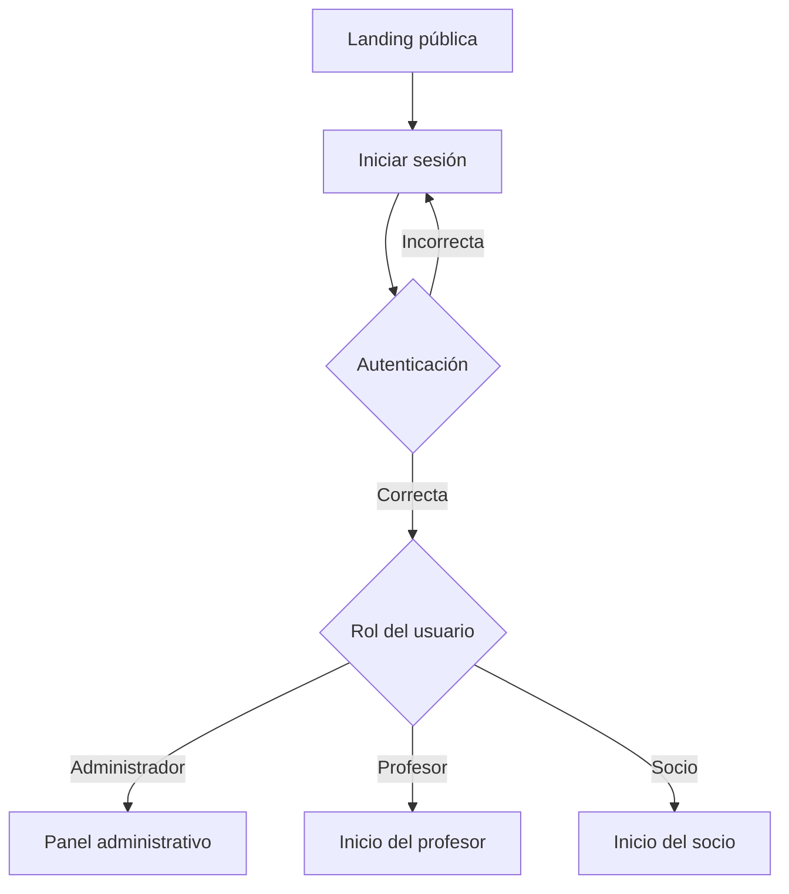
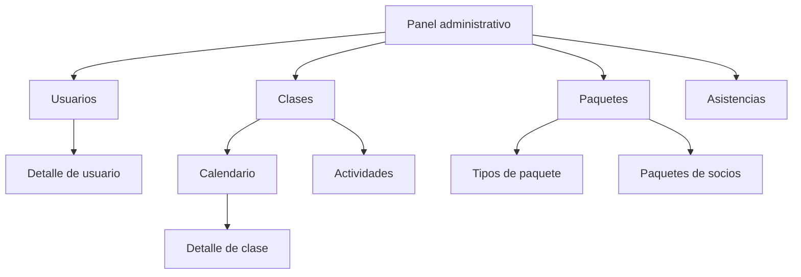
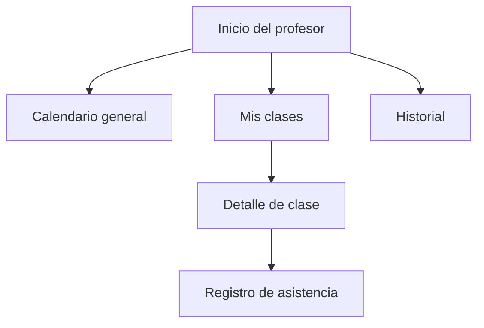
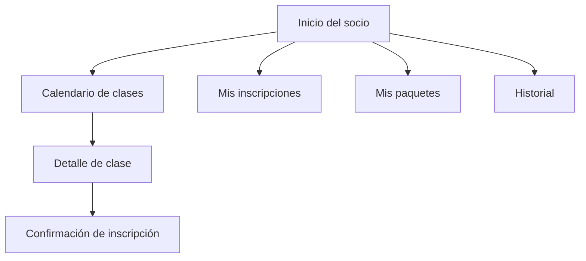
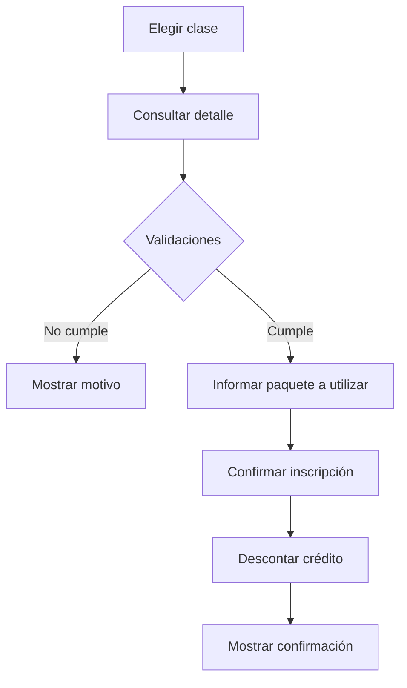
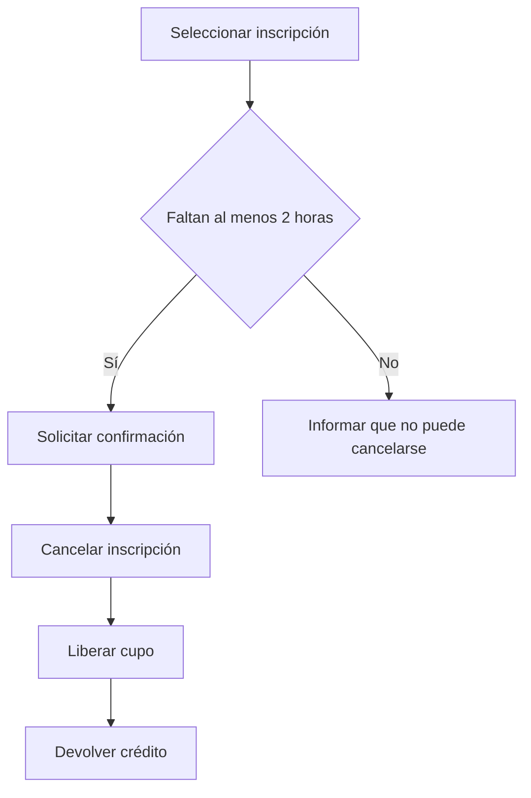

# Diseño de interfaz y experiencia de usuario

## 1. Propósito del documento

Este documento define los lineamientos de diseño de la interfaz de GymFlow, su mapa de navegación, las pantallas previstas, los componentes comunes y los criterios básicos de accesibilidad y adaptación a distintos dispositivos.

El objetivo es establecer una referencia compartida para el diseño y el desarrollo del frontend, mantener la coherencia entre los distintos roles y registrar las decisiones adoptadas durante el proyecto.

El diseño se limita al alcance funcional del MVP. Las funcionalidades excluidas podrán considerarse como mejoras futuras, pero no forman parte de las pantallas ni de los flujos principales definidos en este documento.

### Contenido

1. [Propósito del documento](#1-propósito-del-documento)
2. [Principios de diseño](#2-principios-de-diseño)
3. [Alcance y decisiones de diseño](#3-alcance-y-decisiones-de-diseño)
4. [Perfiles de usuario](#4-perfiles-de-usuario)
5. [Estructura general de navegación](#5-estructura-general-de-navegación)
6. [Catálogo de pantallas](#6-catálogo-de-pantallas)
7. [Flujos funcionales principales](#7-flujos-funcionales-principales)
8. [Estructura de las pantallas](#8-estructura-de-las-pantallas)
9. [Sistema visual](#9-sistema-visual)
10. [Componentes comunes](#10-componentes-comunes)
11. [Estados y mensajes de interfaz](#11-estados-y-mensajes-de-interfaz)
12. [Confirmación de operaciones sensibles](#12-confirmación-de-operaciones-sensibles)
13. [Accesibilidad](#13-accesibilidad)
14. [Wireframes](#14-wireframes)
15. [Relación con el modelo de datos](#15-relación-con-el-modelo-de-datos)
16. [Criterios de validación del diseño](#16-criterios-de-validación-del-diseño)

## 2. Principios de diseño

La interfaz de GymFlow se diseñará de acuerdo con los siguientes principios:

- **Claridad:** cada pantalla debe comunicar su propósito y presentar una acción principal reconocible.
- **Consistencia:** los componentes, colores, etiquetas y comportamientos deben mantenerse uniformes en toda la aplicación.
- **Simplicidad:** se evitarán opciones y datos que no sean necesarios para completar la tarea actual.
- **Accesibilidad:** la información no dependerá únicamente del color y los controles podrán utilizarse mediante teclado.
- **Prevención de errores:** las operaciones sensibles mostrarán sus consecuencias antes de ser confirmadas.
- **Retroalimentación:** toda acción relevante deberá mostrar su resultado, ya sea exitoso o fallido.
- **Adaptabilidad:** la aplicación deberá resultar utilizable tanto en computadoras como en teléfonos y tabletas.
- **Adecuación al rol:** cada usuario visualizará únicamente la información y las operaciones correspondientes a sus permisos.

## 3. Alcance y decisiones de diseño

Se establecen las siguientes decisiones:

- La aplicación contará con una landing page pública básica y un acceso autenticado diferenciado por rol.
- Los roles del sistema serán Administrador, Profesor y Socio.
- La navegación principal de escritorio utilizará una barra lateral y una barra superior.
- En dispositivos móviles, la barra lateral se reemplazará por un menú desplegable.
- El menú del usuario contendrá las opciones **Mi perfil**, **Cambiar contraseña** y **Cerrar sesión**.
- No existirá registro público: las cuentas serán creadas por un administrador.
- La lista de espera queda fuera del MVP.
- Cualquier paquete activo y con créditos podrá utilizarse para cualquier actividad.
- Cuando un socio tenga varios paquetes utilizables, el sistema seleccionará primero el que tenga el vencimiento más próximo.
- La vista predeterminada del calendario será semanal. También se ofrecerán una vista mensual y una vista de lista o agenda.
- En dispositivos móviles se priorizará la vista de agenda.
- Las actividades y las clases pertenecerán a una misma sección de navegación, pero se gestionarán en vistas diferentes.
- La asistencia tendrá tres estados: **Pendiente**, **Presente** y **Ausente**.
- No se registrará el motivo de una cancelación ni se almacenará explícitamente quién la realizó.
- Los historiales y paneles contendrán información operativa básica, sin reportes contables ni analítica avanzada.

## 4. Perfiles de usuario

### 4.1. Administrador

Gestiona usuarios, actividades, clases, paquetes, inscripciones y asistencias. Necesita una visión general del funcionamiento del establecimiento y acceso a operaciones administrativas.

### 4.2. Profesor

Consulta el calendario general y sus clases asignadas. Registra y corrige la asistencia de las personas inscriptas en las clases que dicta.

### 4.3. Socio

Consulta las clases disponibles, realiza y cancela inscripciones, revisa sus paquetes y accede a su historial de inscripciones y asistencias.

## 5. Estructura general de navegación

### 5.1. Área pública

### 5.2. Área del administrador

### 5.3. Área del profesor

### 5.4. Área del socio

Todos los roles podrán acceder desde el menú de usuario a **Mi perfil**, **Cambiar contraseña** y **Cerrar sesión**.

## 6. Catálogo de pantallas

### 6.1. Pantallas públicas y comunes

| Código | Pantalla | Propósito | Contenido o acciones principales |
| --- | --- | --- | --- |
| UI-01 | Landing pública | Presentar GymFlow y permitir el acceso al sistema | Presentación, beneficios, descripción por rol y botón Iniciar sesión |
| UI-02 | Inicio de sesión | Autenticar al usuario | Correo, contraseña, mensajes de validación y botón Ingresar |
| UI-03 | Mi perfil | Consultar y modificar datos personales | Nombre, correo, rol y estado |
| UI-04 | Cambiar contraseña | Permitir el cambio voluntario de contraseña | Contraseña actual, nueva contraseña y confirmación |
| UI-05 | Acceso denegado | Informar una restricción de permisos | Mensaje explicativo y retorno a una ruta permitida |
| UI-06 | Página no encontrada | Informar que una ruta no existe | Mensaje y acceso al inicio correspondiente |

El rol y el estado se mostrarán en el perfil, pero no podrán ser modificados por el propio usuario. El correo podrá modificarse siempre que no se encuentre registrado por otra cuenta.

### 6.2. Pantallas del administrador

| Código | Pantalla | Propósito | Contenido o acciones principales |
| --- | --- | --- | --- |
| ADM-01 | Panel administrativo | Resumir el estado operativo del gimnasio | Indicadores, próximas clases, vencimientos y accesos rápidos |
| ADM-02 | Gestión de usuarios | Administrar cuentas | Listar, buscar, filtrar, crear, editar, activar y desactivar usuarios |
| ADM-03 | Detalle de usuario | Consultar la situación de un usuario | Datos personales, rol, estado, paquetes, inscripciones e historial |
| ADM-04 | Calendario de clases | Administrar la programación | Vistas semanal, mensual y de lista; crear, editar y cancelar clases |
| ADM-05 | Gestión de actividades | Administrar el catálogo de actividades | Listar, crear y editar actividades |
| ADM-06 | Detalle de clase | Consultar y administrar una clase | Actividad, horario, profesor, capacidad, cupos, inscriptos y estado |
| ADM-07 | Tipos de paquete | Administrar las definiciones de paquetes | Nombre, cantidad de créditos y duración |
| ADM-08 | Paquetes de socios | Asignar y consultar paquetes | Socio, tipo, inicio, vencimiento y créditos restantes |
| ADM-09 | Inscripción manual | Inscribir o cancelar a un socio | Selección de socio y clase, validaciones y confirmación |
| ADM-10 | Gestión de asistencia | Consultar y corregir asistencias | Lista de inscriptos y estado de asistencia |

#### Indicadores mínimos del panel administrativo

- Socios activos.
- Clases programadas para el día.
- Clases completas.
- Paquetes próximos a vencer, entendidos como aquellos a los que les quedan siete días o menos de vigencia.
- Ocupación de las próximas clases.

El panel también podrá incluir accesos rápidos para crear un usuario, programar una clase y asignar un paquete.

### 6.3. Pantallas del profesor

| Código | Pantalla | Propósito | Contenido o acciones principales |
| --- | --- | --- | --- |
| PROF-01 | Inicio del profesor | Presentar la actividad inmediata | Próxima clase, clases del día, alumnos esperados y asistencias pendientes |
| PROF-02 | Calendario general | Consultar la programación del gimnasio | Calendario semanal, mensual o agenda con filtros |
| PROF-03 | Mis clases | Consultar clases asignadas | Clases futuras y pasadas, con acceso al detalle |
| PROF-04 | Detalle de clase y asistencia | Registrar la asistencia | Datos de la clase, inscriptos, créditos disponibles y estados de asistencia |
| PROF-05 | Historial de clases | Consultar clases dictadas | Fecha, actividad, cantidad de inscriptos y resumen de asistencia |

El profesor podrá consultar todas las clases del calendario, pero solo podrá registrar o modificar la asistencia de las clases que tenga asignadas.

#### Flujo de registro de asistencia

1. Las inscripciones se crean con asistencia **Pendiente**.
2. El profesor abre una clase asignada.
3. Puede utilizar la acción **Marcar todos como presentes**.
4. Modifica individualmente como **Ausentes** a quienes no asistieron.
5. Revisa y guarda el registro.
6. El profesor o un administrador pueden corregir posteriormente una asistencia guardada.

### 6.4. Pantallas del socio

| Código | Pantalla | Propósito | Contenido o acciones principales |
| --- | --- | --- | --- |
| SOC-01 | Inicio del socio | Resumir su situación actual | Créditos, vencimiento más próximo, próxima clase e inscripciones futuras |
| SOC-02 | Calendario de clases | Explorar clases disponibles | Calendario semanal, mensual o agenda; filtros y cupos restantes |
| SOC-03 | Detalle de clase | Consultar una clase y realizar una inscripción | Actividad, horario, profesor, capacidad, cupos y acción de inscripción |
| SOC-04 | Mis inscripciones | Gestionar las próximas reservas | Próximas clases, detalle y cancelación habilitada |
| SOC-05 | Mis paquetes | Consultar los paquetes asignados | Tipo, vigencia, créditos totales y créditos restantes |
| SOC-06 | Historial y actividad | Consultar la actividad pasada | Inscripciones, cancelaciones, presencias, ausencias y porcentaje de asistencia |

#### Indicadores mínimos del inicio del socio

- Créditos disponibles.
- Vencimiento más próximo.
- Próxima clase.
- Cantidad de inscripciones futuras.
- Porcentaje histórico de asistencia.

Cuando el socio posea varios paquetes activos, el inicio mostrará el vencimiento más próximo y ofrecerá acceso al detalle completo en **Mis paquetes**.

## 7. Flujos funcionales principales

### 7.1. Inscripción de un socio

Antes de permitir la inscripción, el sistema validará:

- que el usuario esté activo y autenticado;
- que la clase no esté cancelada;
- que la clase tenga cupo disponible;
- que el socio no esté previamente inscripto;
- que exista al menos un paquete activo, vigente y con créditos.

Si existen varios paquetes válidos, se seleccionará el que venza primero. Antes de confirmar se informará el nombre del paquete, su vencimiento y que se descontará un crédito.

### 7.2. Cancelación de una inscripción

El mensaje de rechazo deberá indicar claramente que las cancelaciones se permiten hasta dos horas antes del inicio de la clase.

### 7.3. Cancelación de una clase

Cuando el administrador cancele una clase, el sistema deberá:

1. solicitar confirmación e informar sus consecuencias;
2. marcar la clase como cancelada;
3. cancelar sus inscripciones activas;
4. devolver los créditos utilizados;
5. mostrar la clase como cancelada en calendarios e historiales.

## 8. Estructura de las pantallas

### 8.1. Escritorio

Las pantallas autenticadas utilizarán:

- **Barra lateral:** identidad de GymFlow y opciones de navegación permitidas para el rol.
- **Barra superior:** título o contexto actual y menú del usuario.
- **Encabezado de contenido:** título, descripción breve y acción principal cuando corresponda.
- **Área de filtros:** búsqueda, selectores y filtros relevantes.
- **Contenido principal:** tarjetas, tablas, formularios o calendario.
- **Mensajes de estado:** confirmaciones, advertencias y errores.

### 8.2. Dispositivos móviles

- La barra lateral se convertirá en un menú desplegable.
- Las tablas extensas se transformarán en tarjetas o listas.
- El calendario priorizará la agenda diaria o semanal.
- Las acciones primarias permanecerán visibles y no dependerán exclusivamente de menús contextuales.
- Los formularios se organizarán en una sola columna.
- Los controles tendrán un área táctil suficiente.

## 9. Sistema visual

### 9.1. Paleta cromática

| Uso | Color | Código hexadecimal |
| --- | --- | --- |
| Principal | Verde bosque | `#245C45` |
| Secundario | Verde hoja | `#3F7D5C` |
| Acción destacada | Verde fresco | `#5E9B70` |
| Fondo principal | Blanco cálido | `#FCFCFA` |
| Fondo secundario | Gris verdoso claro | `#F3F6F3` |
| Bordes | Gris verdoso | `#DCE5DE` |
| Texto principal | Gris carbón | `#202722` |
| Texto secundario | Gris medio | `#667068` |
| Éxito | Verde | `#2E7D4F` |
| Advertencia | Ámbar | `#B7791F` |
| Error | Rojo | `#C24141` |

El color nunca será el único medio utilizado para comunicar estados. Las clases completas, canceladas o disponibles deberán incluir también etiquetas textuales e iconos comprensibles.

### 9.2. Tipografía

Se utilizará **Montserrat** como tipografía principal:

- títulos: pesos 600 o 700;
- subtítulos y botones: pesos 500 o 600;
- texto general: peso 400;
- etiquetas y textos de ayuda: pesos 400 o 500.

El texto general tendrá un tamaño mínimo recomendado de 16 px, mientras que las etiquetas no deberán ser menores a 14 px.

### 9.3. Estilo de componentes

- Bordes moderadamente redondeados.
- Sombras suaves y reservadas para distinguir niveles de contenido.
- Iconografía sencilla acompañada por texto en las acciones importantes.
- Espaciado uniforme y suficiente separación entre acciones.
- Botón principal limitado a la acción más importante de cada sección.
- Botones destructivos identificados mediante texto explícito y color de error.

## 10. Componentes comunes

La interfaz deberá reutilizar, como mínimo, los siguientes componentes:

- barra lateral;
- barra superior y menú de usuario;
- encabezado de página;
- botones primario, secundario y destructivo;
- campos de texto, selectores y mensajes de validación;
- buscador y filtros;
- tarjetas de indicadores;
- tablas y paginación;
- etiquetas de estado;
- calendario y tarjeta de clase;
- modal de confirmación;
- alertas o notificaciones breves;
- estado de carga;
- estado vacío;
- mensaje de error;
- navegación por páginas cuando corresponda.

## 11. Estados y mensajes de interfaz

Las pantallas que obtengan o modifiquen información deberán representar explícitamente los estados de carga, contenido disponible, vacío, error y éxito. También se contemplarán los estados deshabilitado, confirmación requerida, permiso insuficiente y sesión vencida.

Los estados utilizarán una presentación y un lenguaje consistentes en toda la aplicación. Cada mensaje deberá explicar qué ocurrió y, cuando corresponda, qué puede hacer el usuario a continuación.

### 11.1. Estado de carga

Se mostrará mientras la aplicación espera una respuesta del backend. Su representación dependerá del contexto:

| Contexto | Representación |
| --- | --- |
| Carga inicial de una pantalla | Esqueleto que reproduzca aproximadamente las tarjetas, filas o bloques esperados |
| Tabla o listado | Entre tres y cinco filas esqueleto |
| Panel de indicadores | Tarjetas esqueleto |
| Calendario | Bloques neutros dentro de la estructura del calendario |
| Operación puntual | Indicador dentro del botón y botón temporalmente deshabilitado |

Cuando ya exista contenido visible, una operación puntual no deberá reemplazar toda la pantalla por un indicador de carga. Por ejemplo, al guardar una asistencia se conservará la lista y el botón mostrará **Guardando…**.

Otros mensajes posibles son:

- Cargando clases…
- Consultando inscripciones…
- Actualizando usuario…
- Asignando paquete…

Mientras una operación esté en curso, se impedirá su envío repetido.

### 11.2. Estado vacío

Representa una consulta realizada correctamente que no devolvió datos. No debe presentarse como un error.

Cada estado vacío incluirá:

1. un título que describa la situación;
2. una explicación breve;
3. una acción posible, cuando el usuario pueda resolverla.

| Pantalla o sección | Mensaje | Acción sugerida |
| --- | --- | --- |
| Calendario | No hay clases programadas para el período seleccionado. | Cambiar fecha o quitar filtros |
| Mis inscripciones | No tenés próximas inscripciones. | Explorar clases |
| Mis paquetes | No tenés paquetes activos. | Contactar con administración |
| Historial | Todavía no hay actividad para mostrar. | Volver al inicio |
| Gestión de usuarios | Todavía no hay usuarios registrados. | Crear usuario |
| Resultado de búsqueda | No se encontraron usuarios con los filtros seleccionados. | Quitar filtros |
| Actividades | Todavía no hay actividades registradas. | Crear actividad |
| Clases del profesor | No tenés clases asignadas para este período. | Consultar el calendario general |
| Asistencia | No hay socios inscriptos en esta clase. | Volver a Mis clases |

Se distinguirá entre la ausencia total de registros y una búsqueda sin coincidencias. En el segundo caso se conservarán los filtros para que puedan modificarse.

### 11.3. Estado de error

Los mensajes de error se mostrarán en lenguaje claro, sin exponer trazas, consultas, detalles internos ni información sensible.

#### Error de campo

Se ubicará debajo del campo correspondiente y explicará cómo corregirlo. El campo también deberá quedar identificado visualmente.

Ejemplos:

- Ingresá un correo electrónico.
- El formato del correo no es válido.
- La contraseña es obligatoria.
- La capacidad debe ser mayor que cero.
- La fecha de finalización debe ser posterior a la fecha de inicio.

Los valores ingresados correctamente no deberán borrarse cuando otro campo tenga un error.

#### Error de autenticación

No se revelará cuál de las credenciales es incorrecta. Se utilizará un mensaje general:

> El correo electrónico o la contraseña son incorrectos.

#### Error de operación

Se mostrará cerca del formulario o de la zona en la que se inició la acción. Los datos cargados se conservarán siempre que sea posible.

Ejemplos:

- No pudimos crear el usuario. Revisá los datos e intentá nuevamente.
- No pudimos guardar la asistencia.
- No pudimos asignar el paquete.
- No pudimos actualizar la clase.

#### Error de carga

Reemplazará únicamente el contenido que no pudo obtenerse y ofrecerá la acción **Reintentar**.

> No pudimos cargar las clases. Verificá tu conexión e intentá nuevamente.

#### Error por regla de negocio

Indicará el motivo concreto por el cual la operación no puede realizarse:

- No hay cupos disponibles para esta clase.
- Ya estás inscripto en esta clase.
- No tenés paquetes activos con créditos disponibles.
- La inscripción ya no puede cancelarse porque faltan menos de dos horas para el inicio.
- La clase fue cancelada.
- No tenés permisos para realizar esta acción.

#### Error inesperado

Cuando no pueda ofrecerse una causa específica, se utilizará un mensaje general:

> Ocurrió un problema inesperado. Intentá nuevamente en unos minutos.

### 11.4. Estado de éxito

Confirmará que la operación se completó correctamente y se representará mediante una notificación breve, una confirmación dentro del flujo o una actualización visible del contenido.

#### Notificación breve

Se utilizará cuando el usuario permanezca en la misma pantalla:

- Usuario actualizado correctamente.
- Asistencia guardada.
- Paquete asignado correctamente.
- Cambios guardados.

La notificación podrá desaparecer después de algunos segundos, pero permitirá el cierre manual.

#### Confirmación dentro del flujo

Las operaciones importantes podrán mostrar una confirmación más visible. Por ejemplo:

> **Inscripción confirmada**  
> Te inscribiste en Entrenamiento funcional para el jueves 23/10 a las 17:00. Se descontó un crédito del paquete “8 clases mensuales”.

Podrán ofrecerse las acciones **Ver mis inscripciones** y **Volver al calendario**.

#### Actualización visual

Además del mensaje, la interfaz deberá reflejar inmediatamente el resultado de la operación. Según el caso, deberá:

- actualizar los créditos restantes;
- actualizar los cupos disponibles;
- cambiar **Inscribirme** por **Inscripto**;
- reflejar el nuevo estado de asistencia;
- mostrar una clase como **Cancelada**;
- incorporar, actualizar o quitar una fila de una tabla.

La confirmación de una operación importante no dependerá únicamente de una notificación temporal.

### 11.5. Estado deshabilitado

Los controles no disponibles deberán distinguirse visualmente y mantener un contraste suficiente. Cuando la causa no sea evidente, se incluirá una explicación cercana.

Ejemplos:

- La clase está completa.
- La inscripción ya no puede cancelarse.
- Solo el profesor asignado puede registrar la asistencia.

Cuando resulte útil para comprender el sistema, se mostrará la acción deshabilitada con su explicación en lugar de ocultarla.

### 11.6. Permiso insuficiente

Si un usuario intenta acceder a una ruta o acción no autorizada, el sistema impedirá la operación sin revelar información restringida.

> No tenés permisos para acceder a esta sección.

Se ofrecerá una acción para volver al inicio correspondiente a su rol.

### 11.7. Sesión vencida

Cuando la sesión deje de ser válida, se informará:

> Tu sesión finalizó por seguridad. Volvé a iniciar sesión para continuar.

El usuario será redirigido al inicio de sesión. No se mostrarán errores técnicos relacionados con el token o la autenticación interna.

### 11.8. Criterios comunes para los mensajes

Todos los estados y mensajes deberán:

- utilizar lenguaje directo y consistente;
- indicar qué ocurrió;
- explicar qué puede hacer el usuario;
- conservar los datos ingresados cuando sea posible;
- incluir texto además de color e iconos;
- asociar los errores de validación al campo correspondiente;
- poder ser anunciados por tecnologías de asistencia;
- impedir acciones duplicadas durante una operación en curso;
- mantener la misma terminología en toda la aplicación.

## 12. Confirmación de operaciones sensibles

Se solicitará confirmación antes de:

- cancelar una inscripción;
- cancelar una clase;
- desactivar un usuario;
- corregir una asistencia ya guardada;
- asignar un paquete;
- inscribir manualmente a un socio.

La confirmación deberá describir la consecuencia principal. Por ejemplo:

> ¿Cancelar la clase de Yoga del 24/10 a las 18:00? Las inscripciones activas se cancelarán y se devolverán los créditos utilizados.

## 13. Accesibilidad

La interfaz se diseñará siguiendo estas pautas mínimas:

- contraste suficiente entre texto, controles y fondos;
- etiquetas visibles asociadas a todos los campos;
- navegación mediante teclado;
- indicador de foco claramente visible;
- orden lógico de navegación;
- textos alternativos para imágenes informativas;
- iconos acompañados por etiquetas cuando representen acciones relevantes;
- mensajes de error asociados al campo correspondiente;
- títulos y encabezados con jerarquía semántica;
- áreas táctiles de tamaño suficiente;
- ausencia de información comunicada únicamente mediante color;
- lenguaje directo y comprensible.

## 14. Wireframes

Los wireframes representan la distribución y jerarquía de los elementos antes de implementar el diseño definitivo. Para GymFlow se elaboró una referencia navegable de **media fidelidad**, con contenido ilustrativo, sistema visual preliminar y alternativas para escritorio y dispositivos móviles.

Su objetivo es validar:

- navegación;
- encabezados;
- contenido principal;
- acciones primarias y secundarias;
- formularios y filtros;
- mensajes relevantes;
- adaptación general a escritorio y dispositivos móviles.

Las pantallas representadas son:

1. Inicio de sesión.
2. Panel administrativo.
3. Calendario de clases del socio.
4. Detalle de clase e inscripción.
5. Inicio del socio.
6. Registro de asistencia del profesor.

Estas pantallas cubren los principales patrones de interacción del sistema: autenticación, panel con indicadores, navegación por calendario, consulta de detalles, confirmación de una operación y edición de registros en una tabla.

No se elaborarán wireframes individuales para todas las pantallas del catálogo. Las restantes reutilizarán las estructuras, componentes y comportamientos definidos en esta referencia. Los wireframes no representan el diseño visual definitivo y podrán ajustarse durante la implementación.

## 15. Relación con el modelo de datos

El diseño se basa en las entidades de usuarios, actividades, clases, tipos de paquete, paquetes de socios e inscripciones definidas en el modelo de datos del proyecto.

Para representar correctamente la asistencia, el atributo booleano original deberá sustituirse por un estado con los valores:

- `PENDING`: asistencia todavía no registrada;
- `PRESENT`: socio presente;
- `ABSENT`: socio ausente.

Las cancelaciones se distinguirán a partir de su ámbito:

- una clase cancelada se representará mediante el estado de la clase;
- una inscripción individual cancelada se representará mediante el estado de la reserva.

No se incorporarán al modelo datos de listas de espera, restricciones de actividades por paquete, motivos de cancelación ni cambio obligatorio de contraseña.

## 16. Criterios de validación del diseño

El diseño se considerará validado cuando:

- todas las funciones del MVP estén asociadas a una pantalla o flujo;
- cada rol pueda identificar fácilmente sus tareas principales;
- las operaciones no autorizadas no sean visibles ni accesibles;
- los flujos de inscripción, cancelación y asistencia representen las reglas de negocio;
- las pantallas contemplen estados de carga, vacío, error y éxito;
- la navegación sea coherente entre las distintas vistas;
- exista una alternativa utilizable para dispositivos móviles;
- los wireframes hayan sido revisados por ambas integrantes;
- las decisiones que afecten el alcance o el modelo de datos hayan sido aprobadas antes del desarrollo.
